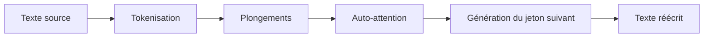

# Présentation orale (7 à 10 minutes)

Machine sur laquelle les chiffres ont été mesurés : Windows 11 Pro, Ryzen 9 7900X3D, 31,1 Gio de mémoire vive, NVIDIA GeForce RTX 5080, **16 303 Mio** de mémoire vidéo (`nvidia-smi`), pilote 617.42. Ce n’est pas un portable Arch et ce n’est pas une RTX 4080. La mémoire vive et la mémoire vidéo sont deux quantités différentes.

Le modèle n’a pas été entraîné dans ce projet. On charge des poids déjà publiés et on génère du texte.

## Déroulé

| Temps | Bloc |
| --- | --- |
| 0:00–1:00 | Le problème |
| 1:00–3:30 | Ce qu’est un Transformer, avec le schéma |
| 3:30–4:30 | Préentraîné ou entraîné ici, et le rôle du prompt |
| 4:30–7:00 | Démonstration (trois phrases) |
| 7:00–8:30 | Chiffres mesurés et un échec réel |
| 8:30–10:00 | Deux forces, deux limites, une amélioration |

## 1. Le problème (environ 1 minute)

On écrit une phrase ordinaire, parfois gênante ou banale. Le programme la réécrit dans une autre voix. La voix principale est un message LinkedIn sérieux : les mots professionnels doivent rester vrais si on les lit au pied de la lettre. L’humour vient du contraste, pas d’un clin d’œil.

Exemple préparé, déjà mesuré, graine 13, température 0,7 :

- Entrée : « I took a massive dump just now »
- Sortie : « I just completed a large-scale system purge at the end of the cycle. All data streams were cleared and the system returned to baseline integrity. #SystemStability #OperationalClosure #DataIntegrity »

La phrase d’entrée n’est pas dans le prompt. Elle sert seulement d’exemple de développement.

## 2. Le Transformer (environ 2 minutes 30)

- **Jeton.** Le texte est découpé en morceaux (mots, bouts de mots, chiffres). Le modèle ne voit pas une phrase, il voit une suite d’identifiants.
- **Plongement.** Chaque identifiant devient un vecteur de nombres. Ici, la taille cachée du modèle Qwen3-4B est 2560. C’est la fiche du modèle, pas une mesure faite en coupant le réseau.
- **Auto-attention.** Pour prédire la suite, chaque position regarde les autres. Elle construit une requête, des clés et des valeurs. Le poids d’attention dit quelles positions comptent. Qwen3-4B a 36 couches, 32 têtes de requête et 8 têtes clé-valeur. C’est de l’attention groupée, toujours le même principe.
- **Génération.** Le réseau produit une distribution sur le prochain jeton. On tire un jeton (`do_sample`, température 0,7, top_p 0,8, top_k 20), on l’ajoute à la suite, et on recommence. On ne décode que les jetons nouveaux. Les poids ne bougent pas : `model.eval()` et `torch.inference_mode()`.

Phrase simple pour la classe : un Transformer génératif devine le prochain morceau de texte en laissant chaque morceau déjà écrit influencer cette devinette.

## 3. Préentraîné, et le prompt n’est pas un entraînement (environ 1 minute)

Qwen a déjà fait le préentraînement (prédire des jetons) et l’alignement par instructions. Nous, on télécharge `huihui-ai/Huihui-Qwen3-4B-Instruct-2507-abliterated` (Apache 2.0, environ 4 milliards de paramètres, précision BF16) et on appelle `generate`. Ce fichier est une ablitération de `Qwen/Qwen3-4B-Instruct-2507` : une direction de refus est retirée des poids déjà entraînés. Ce n’est pas un entraînement depuis zéro, et ce n’est pas l’élève qui entraîne les poids.

Le fichier `styles.yaml` change la consigne, pas les poids. Une mauvaise consigne donne un mauvais texte avec le même réseau. On l’a vu : une version plus stricte du prompt (r2) a inventé l’heure « 3:17 p.m. » sur la phrase de référence. On est revenu à la version r1.

Ce n’est pas de l’apprentissage supervisé fait par l’élève. Il n’y a pas de boucle de perte, pas de séparation entraînement/test au sens d’un ajustement de poids. Le découpage dev/test sert à choisir la consigne sans noter la consigne sur les phrases qui ont servi à la choisir.

## 4. Démonstration (2 à 3 minutes)

Le détail des trois phrases, avec la graine, est dans `school/demo.md`. Montrer :

1. La phrase de référence en LinkedIn motivationnel.
2. « I burned the rice. » en voix ChatGPT : « Certainly. You burned the rice. »
3. La même phrase de riz en LinkedIn, pour que la classe voie le changement de voix.

Dire à voix haute le chemin : le texte entre dans le message utilisateur, les règles sont dans le message système, le modèle est déjà sur la carte graphique, la réponse est seulement les nouveaux jetons.

## 5. Chiffres et un échec (environ 1 minute 30)

Tous ces chiffres viennent de `docs/evaluation_report.md` et des fichiers `benchmarks/results/`.

- Poids en mémoire après le chargement : **7 672,3 Mio**. Pointe autour de **7 800 Mio** pendant la génération. La carte en a 16 303. Le 4 bits n’était pas nécessaire.
- Sur les 8 phrases de développement, variante D, température 0,7 : latence moyenne **3,35 s**, et les 4 phrases qui contiennent un chiffre l’ont toutes gardé.
- La paraphrase simple (variante A) gardait aussi les chiffres (rétention 1,0) mais écrivait « bowel movement » et `#BowelHealth`. Elle nomme le sujet. Elle a été écartée pour ça, pas à cause d’un score inventé.
- Les 32 phrases de test, consigne figée : latence moyenne **4,19 s**, médiane **3,98 s**, maximum **7,60 s**. Sur les 13 phrases qui ont un chiffre, la rétention moyenne est **0,81**. Trois de ces 13 en perdent au moins un.

Échec à montrer : « I owed Maya $18 and paid her back $20 by mistake. » Le modèle a gardé 20, a effacé 18, et a écrit un surplus de 2 $. Il a fait la soustraction au lieu de copier les deux nombres. La consigne dit pourtant de copier chaque chiffre. Un modèle de 4 milliards de paramètres n’obéit pas à toutes les consignes. Le score automatique le voit. Un score d’humour humain n’a pas été rempli.

## 6. Deux forces, deux limites, une suite (environ 1 minute 30)

Forces :

- La même phrase change vraiment de voix, et la métaphore de la phrase de référence reste sérieuse sans nommer l’acte.
- Tout reste sur la machine. Une réponse courte prend quelques secondes une fois les poids chargés. Aucun appel Gemini, OpenAI, Groq ou Claude.

Limites :

- Les chiffres sautent ou sont remplacés par des mots (« 8 » devient « eight ») ou par un calcul (18 et 20 deviennent « surplus de 2 »).
- Le modèle nomme encore l’objet (le pain grillé, le poisson) ou invente une suite (un correctif, une heure, un « follow-up »). Resserrer le prompt sur le jeu de développement a empiré l’exemple principal. C’est une limite du modèle, pas un détail de code.

Amélioration raisonnable : un contrôle automatique qui refuse une sortie dont un chiffre source a disparu, puis une seule régénération contrainte. Le second passage existe dans le code et il est éteint. Il ne vérifie pas les chiffres aujourd’hui. On peut aussi faire noter les textes par des humains : les cases 1 à 5 sont vides volontairement.
